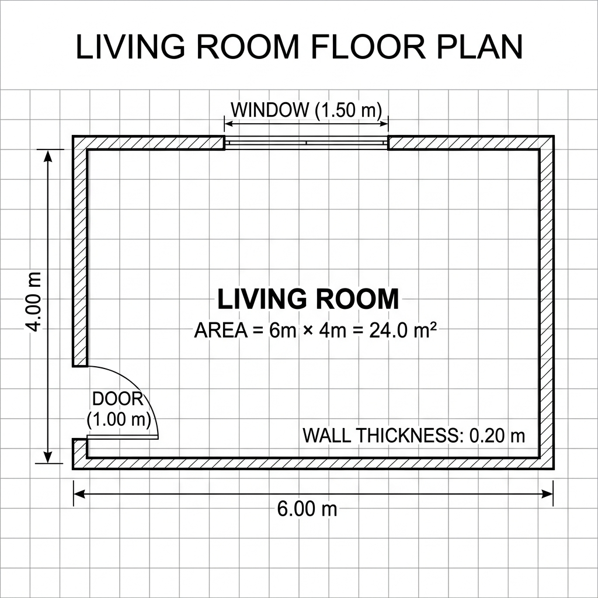
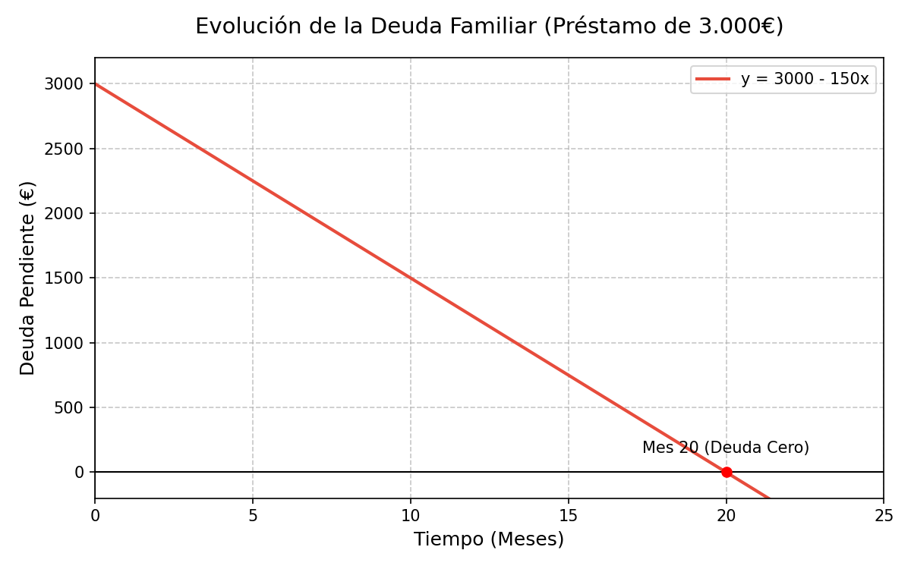
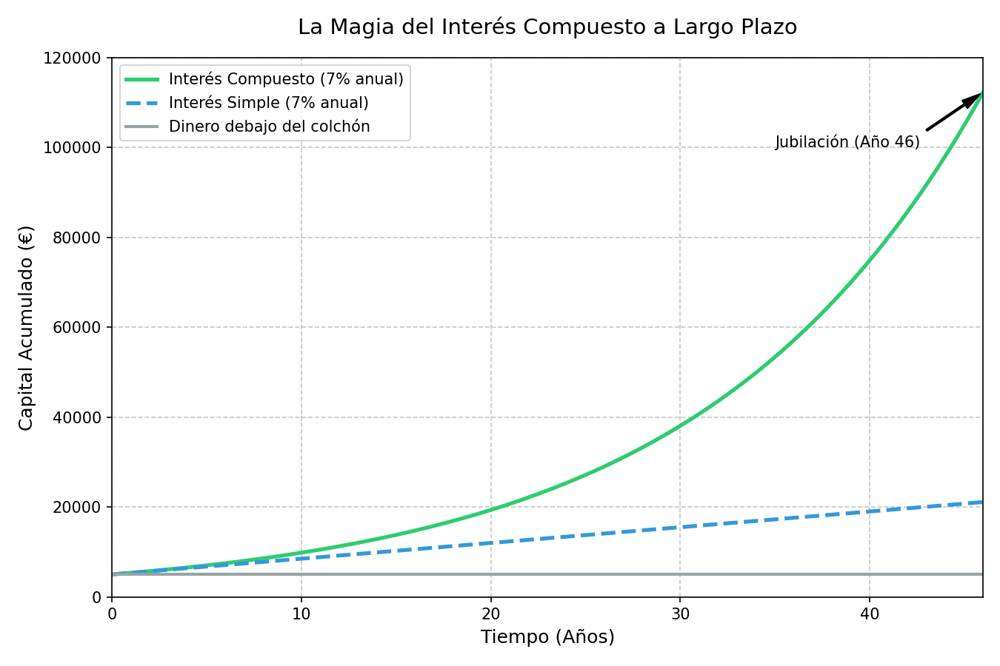

# 💸 Proyecto de Vida: De Estudiante a Adulto Independiente

## 📌 Guía Docente
Este proyecto está diseñado para alumnos de **3º de la ESO**, estructurado en **20 sesiones de 30 minutos**. A lo largo del proyecto, los alumnos asumirán el rol de **Álex**, un joven de 20 años que acaba de independizarse en **Enero de 2026**. 
El objetivo es resolver situaciones cotidianas utilizando matemáticas (porcentajes, interés simple/compuesto, funciones y geometría), interiorizando a la fuerza los conceptos y el vocabulario de la economía familiar real de España.

> **Orientación Docente:** Fomenta que el alumno busque términos en Internet (SMI, IRPF, TAE) antes de darle la solución o la fórmula. Todas las actividades están concatenadas: *¡Ojo! Los datos calculados en la Sesión 2 serán necesarios en la Sesión 14, obligando al alumno a llevar un portafolio o cuaderno organizado.*

---

## 💼 BLOQUE 1: El Mercado Laboral (Sesiones 1 a 4)

### Sesión 1: El primer contrato y el salario bruto (30 min)
**Contexto:** Álex firma su primer contrato a tiempo completo en enero de 2026. La empresa le ofrece un salario referenciado al Salario Mínimo Interprofesional (SMI) proyectado para 2026, que asciende a **1.250 € brutos mensuales en 14 pagas**. Sin embargo, la empresa de Álex prorratea (divide) las pagas extra, por lo que cobrará su sueldo repartido en 12 pagas a lo largo del año.
**Actividades:**
1. Calcula el **Salario Bruto Anual** de Álex.
2. ¿Cuál será su **Salario Bruto Mensual** al estar prorrateadas las pagas en 12 meses?
3. **Investiga:** ¿Qué significa la palabra "Bruto" en economía? ¿Por qué crees que las empresas negocian los sueldos en bruto y no en "Neto"?

### Sesión 2: Entendiendo la nómina (30 min)
**Contexto:** Llega fin de mes y Álex se lleva una sorpresa. En su cuenta bancaria no han ingresado el Salario Bruto Mensual calculado ayer. Ha sufrido "retenciones y cotizaciones".

*Estructura básica de su primera nómina:*
| Concepto | Base de Cálculo | Porcentaje a descontar | Total Descontado (€) |
| :--- | :---: | :---: | :---: |
| Salario Bruto Mensual | - | - | **_____ €** |
| Retención IRPF | Salario Bruto | 12,50% | - _____ € |
| Cuota Seguridad Social | Salario Bruto | 6,55% | - _____ € |
| **SALARIO NETO** (Líquido a percibir) | | | **_____ €** |

**Actividades:**
1. **Investiga:** Busca qué significan las siglas IRPF, Contingencias Comunes, y MEI.
2. Basándote en el salario bruto mensual calculado en la Sesión 1, rellena los huecos de la tabla superior.
3. ¿A qué cantidad total asciende el dinero retenido por el Estado?
4. Calcula el **Salario Neto Mensual** final de Álex. *(Guarda este dato en rojo en tu cuaderno, será vital para el resto del proyecto).*

### Sesión 3: Incrementos porcentuales y convenios (30 min)
**Contexto:** Ha pasado un año. Estamos en 2027. El convenio colectivo sectorial de la empresa de Álex dictamina que todos los salarios base deben subir un **3,5%**.
**Actividades:**
1. Calcula el nuevo Salario Bruto Anual de Álex tras la subida.
2. Si los porcentajes de impuestos (IRPF) y Seguridad Social se mantienen idénticos, ¿cuál es su nuevo Salario Neto Mensual?
3. **Reflexión:** ¿Ha subido el sueldo neto en euros exactamente lo mismo que subió el salario bruto? Demuéstralo matemáticamente.

### Sesión 4: La inflación, el impuesto silencioso (30 min)
**Contexto:** Álex está contento con su subida del 3,5%. Sin embargo, lee en las noticias que el **IPC (Índice de Precios al Consumo)** de 2026 cerró en un **4,2%**.
**Actividades:**
1. **Investiga:** ¿Qué es la inflación? ¿Qué significa "perder poder adquisitivo"?
2. Si la cesta de la compra y gastos mensuales de Álex sumaban exactamente 1.000 € en enero de 2026, ¿cuánto le costarán esos mismos bienes y servicios un año después con la subida del IPC?
3. Analiza los datos de tu libreta: Sueldo de la Sesión 3 vs Gastos calculados ahora. ¿Es Álex ahora más rico o más pobre que el año pasado, en términos de capacidad de compra? *(Resolución mediante porcentajes encadenados).*

---

## 🏠 BLOQUE 2: Independizarse y la Vivienda (Sesiones 5 a 8)

### Sesión 5: El mercado del alquiler y la fianza (30 min)
**Contexto:** Álex busca piso para independizarse. Encuentra un apartamento amueblado por **600 € / mes**. La normativa vigente (Ley de Arrendamientos Urbanos) exige pagar en la firma del contrato: el mes en curso, **dos meses de fianza legal** y, en este caso particular, un seguro de impago equivalente al 50% de una mensualidad.
**Actividades:**
1. ¿Qué desembolso de dinero inicial total debe aportar Álex para que le den las llaves?
2. Calcula qué porcentaje de su **Salario Neto Mensual de 2026 (dato Sesión 2)** representa la cuota mensual del alquiler (600€). 
3. **Investiga:** Los expertos financieros del Banco de España recomiendan que el pago de la vivienda (alquiler o hipoteca) no supere el 30%-35% de los ingresos netos. ¿Cumple Álex esta regla de salud financiera? Si no es así, ¿qué soluciones plantearías?

### Sesión 6: Suministros, facturas e impuestos indirectos (30 min)
**Contexto:** Llegan las primeras facturas del piso. En España, los servicios y bienes de consumo tienen diferentes tipos de **IVA (Impuesto sobre el Valor Añadido)**.
**Actividades:**
1. **Factura del Agua:** La *Base Imponible* (el coste del servicio) es 35 €. El IVA a aplicar es el tipo reducido del 10%. Calcula la cuota final (precio total).
2. **Factura de Internet y Móvil:** La compañía ofrece una tarifa plana de 40 € a la que hay que sumarle el IVA general (21%). Calcula el importe final a pagar.
3. **Investiga:** ¿Cuál es la diferencia conceptual principal entre el IVA (un impuesto indirecto) y el IRPF (un impuesto directo que vimos en la Sesión 2)?

### Sesión 7: Reformas en casa (Geometría y Presupuestos) (30 min)
**Contexto:** El propietario le permite a Álex pintar el salón a su gusto y se lo descontará del alquiler. El salón tiene forma rectangular de **6 metros de largo por 4 metros de ancho**, y la altura del techo es de **2,5 metros**. Hay una única puerta (2m x 1m) y una ventana (2m x 1,5m).

**Actividades:**
1. Apóyate en el plano y aplica tus conocimientos de geometría espacial para calcular la superficie (m²) total de las 4 paredes que hay que pintar, recordando restar los huecos de la puerta y la ventana.
2. Un bote de pintura plástica de 4 Litros cuesta 35 € (IVA incluido) y rinde para cubrir 40 m². ¿Cuántos botes enteros necesita comprar obligatoriamente?
3. ¿A cuánto asciende la factura total en la tienda de bricolaje? 

### Sesión 8: Descuentos comerciales y porcentajes encadenados (30 min)
**Contexto:** Álex necesita comprar un sofá. Encuentra uno en una tienda de muebles cuyo precio de etiqueta es **450 €**. El comercio anuncia un "Gran Descuento de Invierno del 20%". Además, por descargarse la App de la tienda, le aplican un "10% de descuento adicional sobre el precio ya rebajado".

| Precio Inicial | Tras aplicar el 20% | Tras aplicar el 10% adicional |
| :---: | :---: | :---: |
| 450 € | _____ € | **_____ €** |

**Actividades:**
1. Completa la tabla calculando los importes paso a paso para hallar el precio final que pagará Álex por el sofá.
2. **Razonamiento:** ¿Un descuento del 20% seguido de uno del 10% equivale a un descuento directo del 30% sobre los 450€ iniciales? Demuestra matemáticamente tu respuesta.
3. Si el precio final que pagó en la tercera columna ya incluye el 21% de IVA, retrocede el cálculo: ¿cuál era la *Base Imponible* (precio sin IVA) de su compra?

---

## 🚗 BLOQUE 3: Deudas y Financiación (Sesiones 9 a 13)

### Sesión 9: Comprar un coche (30 min)
**Contexto:** Para ir a trabajar, Álex necesita un coche. Ve uno de segunda mano en un concesionario por **12.500 €**. Como sus ahorros no son suficientes, solicita un préstamo personal al banco.
**Actividades:**
1. **Investiga:** Busca en Internet la diferencia entre **TIN** (Tipo de Interés Nominal) y **TAE** (Tasa Anual Equivalente). ¿En cuál debe fijarse un consumidor?
2. El banco le presta los 12.500 € a devolver en **4 años**. El préstamo tiene unos "gastos de apertura y estudio" del 2% sobre el capital total prestado, que le cobran de golpe el primer día. Calcula cuánto dinero le quita el banco en comisiones nada más empezar.

### Sesión 10: Interés Simple vs Compuesto en préstamos (30 min)
**Contexto:** Para entender la magnitud de contraer deuda, Álex hace unos cálculos previos antes de firmar.
**Actividades:**
1. Imagina que el préstamo funcionara con **Interés Simple** a un 7,5% anual durante los 4 años enteros sobre el capital original. Calcula cuánto dinero pagaría *solo en intereses* utilizando la fórmula $I = C \cdot r \cdot t$.
2. Suma los intereses al capital de 12.500 € y divídelo entre las mensualidades (48 meses). ¿Qué cuota mensual aproximada pagaría?
3. *Nota del profesor: En la realidad los bancos usan el sistema francés (amortización que combina interés compuesto y capital vivo decreciente), pero esta aproximación sirve a Álex para entender si la cuota arruinará su presupuesto.*

### Sesión 11: Tarjetas de Crédito ("Revolving") (30 min)
**Contexto:** Al salir del supermercado, una comercial le ofrece a Álex una tarjeta de crédito gratuita que le permite pagar todas sus compras fraccionándolas de forma cómoda: "Paga solo 30 € al mes pase lo que pase".
**Actividades:**
1. **Investiga:** ¿Qué es una tarjeta *revolving*? ¿Por qué es un producto financiero de alto riesgo según el Banco de España?
2. Álex acepta y compra una televisión de 800 € pagando con ella. El tipo de interés de la tarjeta es un **24% TAE (Interés Compuesto Anual)**. 
3. Calcula cuánto interés se genera el primer mes (pista: divide el 24% entre 12 meses, y aplícalo a 800€). Si su cuota fija pactada es de 30 € al mes, ¿cuánto dinero está quitándose realmente de la deuda principal (amortizando) durante ese primer mes?

### Sesión 12: Estudio de funciones: Endeudamiento sin intereses (30 min)
**Contexto:** Visualizar una deuda en una gráfica nos hace comprender mejor su duración y el esfuerzo necesario para cancelarla.

**Actividades:**
1. Un familiar se apiada de Álex y le presta 3.000 € para cancelar sus deudas urgentes a "tipo de interés cero", pidiendo que se lo devuelva pagando 150 € al mes de forma estricta.
2. Escribe la expresión algebraica de la función lineal que representa el dinero que Álex debe al familiar ($y$) en función de los meses transcurridos ($x$): $y = \text{Capital} - (\text{Cuota} \cdot x)$.
3. Dibuja tu propia gráfica y compárala con la proporcionada arriba. ¿En qué mes exacto cruza la recta el eje de abscisas (es decir, el mes en que la deuda es cero)?

### Sesión 13: La trampa de las penalizaciones encadenadas (30 min)
**Contexto:** Una pequeña crisis. Álex tiene un gasto imprevisto y no puede pagar una mensualidad de 200 € de un microcrédito.
**Actividades:**
1. La entidad financiera le aplica un "recargo por demora" del 5% sobre la cuota impagada. 
2. Al mes siguiente tampoco puede pagar. La entidad le aplica un nuevo recargo del 5% pero esta vez *sobre la deuda total acumulada* (la cuota inicial más el recargo anterior).
3. ¿Cuánto dinero debe exactamente correspondientes a esa única cuota original de 200 € tras pasar 3 meses impagada? Observa cómo crece de forma compuesta el castigo por impago.

---

## 📈 BLOQUE 4: Ahorro e Inversión para el Futuro (Sesiones 14 a 17)

### Sesión 14: El Fondo de Emergencia (30 min)
**Contexto:** Tras los sustos pasados, Álex decide organizar sus finanzas. Se fija un objetivo innegociable: crear un colchón de dinero equivalente a 3 meses completos de sus gastos de supervivencia para imprevistos. Sus gastos fijos de supervivencia (alquiler, luz, agua, comida básica) son **950 € mensuales**.
**Actividades:**
1. Calcula la cantidad monetaria objetivo de su **Fondo de Emergencia**.
2. Álex diseña una estrategia para apartar religiosamente el **12% de su Salario Neto (busca el dato en la Sesión 2)** nada más cobrarlo. ¿Cuántos meses enteros tardará en alcanzar su fondo de emergencia completo?
3. Mete el dinero en una "cuenta de ahorro remunerada" que el banco le publicita al **2,5% TAE**. Calculando por interés simple, ¿cuántos euros le pagará el banco si mantiene su fondo quieto y completo allí durante 1 año?

### Sesión 15: La Magia del Interés Compuesto (30 min)
**Contexto:** Álex lee un libro de educación financiera y descubre que debe poner a trabajar sus ahorros a largo plazo para luchar contra la inflación que estudió en la Sesión 4.

| Horizonte Temporal ($t$) | Fórmula | Capital Final Acumulado |
| :---: | :---: | :---: |
| 10 años | $5000 \cdot (1 + 0.07)^{10}$ | _____ € |
| 30 años | $5000 \cdot (1 + 0.07)^{30}$ | _____ € |
| 46 años (Jubilación) | $5000 \cdot (1 + 0.07)^{46}$ | _____ € |

**Actividades:**
1. **Investiga:** ¿Qué es un Fondo de Inversión Indexado (gestión pasiva)?
2. A sus 21 años, decide invertir **5.000 €** iniciales en la bolsa mundial. Históricamente, la rentabilidad promediada a largo plazo ha sido de un **7% anual**.
3. Completa la tabla superior utilizando la fórmula del Interés Compuesto: $C_f = C_i \cdot (1 + r)^t$, para descubrir el enorme Capital Final que tendrá sin haber aportado ni un solo euro más de su bolsillo.

### Sesión 16: Funciones Exponenciales de la Riqueza (30 min)
**Contexto:** Visualizar gráficamente por qué se dice que el Interés Compuesto es un multiplicador de riqueza imparable a largo plazo.

**Actividades:**
1. Observa el gráfico proporcionado que compara la inversión de Álex con la opción de guardar el dinero debajo del colchón. Ubica los puntos calculados en la Sesión 15 sobre la curva verde.
2. Identifica en qué momento (aproximado) la curva exponencial verde empieza a separarse bruscamente de la línea recta azul del interés simple.
3. Explica con tus palabras y usando razonamiento matemático a qué se debe la forma de esta curva tan explosiva en sus últimos tramos (Diferencia visual entre función lineal y exponencial).

### Sesión 17: Retenciones e Impuestos del Ahorro (30 min)
**Contexto:** Cuando ganas dinero en inversiones o en el banco, el Estado (Hacienda) cobra un impuesto por "Rendimientos del Capital Mobiliario".
**Actividades:**
1. En España en 2026, la retención base para los primeros beneficios de los ahorros y depósitos es del **19%**.
2. Vuelve a la Sesión 14. Cuando el banco le pagó los intereses de su Fondo de Emergencia, le "retuvo" automáticamente el 19% de IRPF sobre el beneficio antes de ingresárselo en cuenta.
3. Calcula de nuevo: ¿Cuál fue su ganancia bruta (antes de impuestos)? Calcula el porcentaje de resta, ¿Qué importe monetario (ganancia neta) llegó realmente al bolsillo de Álex?

---

## 🏛️ BLOQUE 5: Cotizaciones, Subvenciones y Cierre (Sesiones 18 a 20)

### Sesión 18: El sistema de pensiones y el coste empresarial (30 min)
**Contexto:** Álex vuelve a mirar su nómina. Sabe lo que le quitan de Seguridad Social (Sesión 2), pero no sabe cuánto paga la empresa.
**Actividades:**
1. **Investiga:** ¿Cómo funciona de forma básica el sistema de reparto de pensiones en España? (El concepto de solidaridad intergeneracional).
2. La empresa de Álex, además de pagarle su Salario Bruto, está obligada por ley a pagar a la Seguridad Social (Cuota Patronal) aproximadamente un **31,4% extra** calculado sobre dicho Salario Bruto.
3. Calcula el **Coste Total Real** que asume la empresa cada mes por tener a Álex trabajando. Analiza la diferencia (la brecha) entre lo que la empresa paga de su cuenta bancaria y el Salario Neto que realmente le llega a Álex al mes.

### Sesión 19: Las ayudas estatales y la trampa del IRPF (30 min)
**Contexto:** Para ayudarle a pagar los 600€ del piso, el Gobierno le concede el "Bono Alquiler Joven".
**Actividades:**
1. El bono consiste en una transferencia directa de **250 € mensuales** durante 12 meses exactos. ¿Cuánto dinero recibe Álex de subvención en total durante el año?
2. **Atención a la letra pequeña:** Esta ayuda cuenta como "Ganancia Patrimonial". En la campaña de la Renta del año siguiente, al hacer la declaración, Álex comprueba que su tipo impositivo marginal es del **24%**. Hacienda le reclama el 24% de toda la ayuda que recibió el año anterior.
3. Calcula cuánto dinero tendrá que devolver a Hacienda en primavera. En conclusión, ¿cuánto dinero "limpio" o neto supuso realmente la ayuda en el bolsillo de Álex a lo largo del año?

### Sesión 20: Balance Final, Portfolio y Reflexiones (30 min)
**Contexto:** Es el momento de recoger todo el trabajo de tu cuaderno y cerrar el proyecto de vida de Álex.
**Actividades:**
1. **Elaboración de Decálogo:** Basándote en los errores, peligros y aciertos que ha vivido Álex (préstamos caros, tarjetas revolving, inflación, necesidad de emergencia, interés compuesto), redacta 3 "Reglas de Oro Financieras" fundamentales para entregar a un amigo que acaba de cumplir 18 años.
2. Puesta en común oral en clase: Cada estudiante usará un mínimo de 3 conceptos financieros aprendidos de forma precisa dentro de una explicación.
3. **Reflexión final y debate:** Antes de este proyecto, ¿pensabas que las matemáticas no servían en el mundo real adulto? ¿Te sientes ahora más preparado para que un banco o un contrato no te engañe en el futuro?
